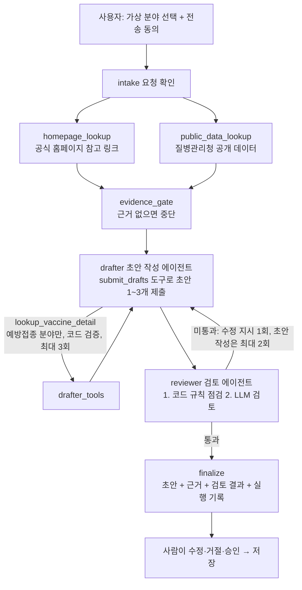

# 이음 (Ieum) · 가족 돌봄 업무 조정 MVP

> **공개 가상 시연입니다. 실제 서비스가 아닙니다.** 로그인·동의·권한 검증이 없어 누구나 같은 가상 데이터를 열람·변경할 수 있습니다. 실제 이름, 연락처, 건강정보 등 개인정보를 입력하지 마세요.

부모님 돌봄에 필요한 확인 업무를 한곳에 모으고, 가족이 역할을 나누며, 진행 상황을 함께 보는 웹 앱입니다. 청도 해커톤 출품용 MVP입니다.

- 소개자료 PDF: [docs/ieum-intro.pdf](docs/ieum-intro.pdf)
- 공개 시연 URL: https://ieum.mangostone-78c3018e.eastus.azurecontainerapps.io (Azure VM이 중지되면 서비스도 중지됩니다. 첫 접속이 느릴 수 있습니다.)
- 제품 범위 [PRD.md](PRD.md) · 기술 설계 [TRD.md](TRD.md) · 결정과 근거 [TDD.md](TDD.md) · 개발 규칙 [AGENTS.md](AGENTS.md)

## 무엇을 하나요

| 기능 | 내용 | 상태 |
|---|---|---|
| 할 일과 업무 보드 | 복지·지역 프로그램, 예방접종·검진, 방문·안부 확인 업무를 기한·출처·상태와 함께 기록하고 변경 이력을 남깁니다. 대시보드는 기한 지난 일, 기한 임박, 미배정, 진행 중 업무를 구분하고 분야·상태 필터와 목록/상태별 보드 전환을 제공합니다. | 구현 |
| 담당 요청과 수락 | 담당은 일방 지정하지 않습니다. 요청받은 가족이 수락해야 확정되고, 거절·조정하면 미배정으로 남습니다. 이 규칙은 서버가 검증합니다. 응답 대기 중의 상태 변경이나 다른 구성원 요청은 거부하고(409), 응답은 요청받은 가상 구성원 ID로만 받습니다(403). 담당 상태와 업무 상태의 일관성은 DB CHECK 제약과 행 잠금으로 지킵니다. 로그인이 없어 응답자 신원은 확인하지 않습니다. | 구현 |
| 공개 데이터 조회 | 병원 검색·진료과목(건강보험심사평가원), 예방접종 대상 감염병 목록·상세(질병관리청)를 공공데이터포털 API로 조회하고 출처·조회 시각을 표시합니다. | 구현 |
| AI 업무 초안 | LangGraph 멀티 에이전트가 근거를 모으고 초안을 쓰고 검토합니다. 결과는 초안이며 사용자가 수정·거절·승인한 뒤에만 저장됩니다. | 구현 |
| 실제 사용자 인증·동의·권한 | 외부 가족 계정용 인증 제품(Entra External ID) 도입을 검토 중입니다. | 계획 |
| 알림(푸시·문자·이메일), 외부 Jira, 개인별 자격 판정, 정부24·국민건강보험공단 개인 데이터 | 범위에서 제외했습니다. | 제외 |

## AI 초안 흐름 (LangGraph 멀티 에이전트)



- 검토 에이전트는 자격·대상 판정, 의료 조언, 연락처·날짜 추정, 개인정보 요구, 지시 변경 문구, 근거 밖 링크를 걸러냅니다. 끝까지 통과하지 못하면 초안을 보여주지 않습니다.
- 모델은 LangChain 공급자 설정으로 바꿉니다. 기본값은 Anthropic Claude Sonnet(`anthropic:claude-sonnet-5-5`)이며 `openai:`·`azure_openai:` 공급자도 설정할 수 있습니다(실제 실행은 Anthropic만 확인).
- 단계 진행은 `POST /api/agent/draft/stream`에서 SSE(Server-Sent Events)로 보냅니다. 공개 시연은 전체 사용자 합산 하루 10회로 제한합니다.

## 기술 구조

| 영역 | 사용 기술 |
|---|---|
| 웹 | React 19, TypeScript, Vite, 반응형 |
| API | Python 3.12, FastAPI, Uvicorn |
| 에이전트 | LangGraph, LangChain (`init_chat_model`), Pydantic 스키마 검증 |
| 데이터 | PostgreSQL 17 (Docker Compose), SQLAlchemy, psycopg |
| 배포 | Azure VM의 Docker Compose + Azure Container Apps HTTPS 게이트웨이. Azure OpenAI·Foundry는 필수가 아니며 필요한 서비스만 썼습니다. |
| 비밀 | 접근 제한된 `.env` 또는 서비스 환경 설정. 코드·문서·로그에 넣지 않습니다. |
| 관찰 | VM의 컨테이너·시스템 로그. uvicorn과 nginx의 접근 로그를 끄고, 공공데이터포털 호출 URL은 httpx 로그에서 제외하며, 오류는 예외 종류만 남깁니다. 프롬프트·개인정보·상담 원문은 남기지 않습니다. |
| 운영 | 상태 점검과 `depends_on: service_healthy`로 DB → API → 웹 순서로 기동하고 `restart: unless-stopped`를 둡니다. PostgreSQL 포트는 VM 로컬(127.0.0.1)에만 열고 백엔드는 비루트 사용자로 실행합니다. `/api/agent/`는 스트리밍을 위해 프록시 버퍼링 없이 150초까지 기다립니다. |

## 실행하기

요구사항: Docker Compose, 공공데이터포털 인증키(공개 데이터 조회용), 모델 공급자 API 키(AI 초안용).

1. 프로젝트 루트에 `.env`를 만듭니다. 값은 저장소에 올리지 않습니다.

   | 변수 | 설명 |
   |---|---|
   | `POSTGRES_PASSWORD` | 필수. PostgreSQL 비밀번호 |
   | `DATA_GO_KR_SERVICE_KEY` 또는 `PUBLIC_DECODING_KEY` | 공공데이터포털 인증키(디코딩 키) |
   | `CARE_AI_ENABLED` | `true`면 AI 초안 사용 |
   | `CARE_LLM_MODEL` | `공급자:모델`. 기본 `anthropic:claude-sonnet-5-5` |
   | `ANTHROPIC_API_KEY` | Anthropic 공급자 키. OpenAI는 `OPENAI_API_KEY`, Azure OpenAI는 `AZURE_OPENAI_API_KEY`·`AZURE_OPENAI_ENDPOINT`·`OPENAI_API_VERSION` |
   | `CARE_LLM_REVIEWER_MODEL`, `CARE_LLM_EFFORT`, `CARE_AI_TIMEOUT_SECONDS` | 선택. 검토 모델, Anthropic 추론 강도(기본 low), 전체 시간 제한(기본 120초) |

   전제: `postgres` 데이터베이스에 시연 원본 표 `public.chengdo_table`이 미리 있어야 합니다(열: `task_id`, `title`, `description`, `category`, `due_date`, `status`). 저장소에는 이 표를 만들거나 `demo_tasks.csv`(12건)를 불러오는 스크립트가 없으므로 새 환경에서는 직접 불러와야 합니다. 표가 없으면 `/api/health`가 503을 돌려주고 백엔드 상태 점검이 실패해 `--wait`가 실패합니다.

2. 컨테이너를 올립니다.

   ```bash
   docker compose up -d --build --wait
   docker compose ps
   ```

3. 브라우저에서 `http://localhost:3500`에 접속합니다. 브라우저의 `/api/` 요청은 프론트엔드 프록시를 거쳐 백엔드로 갑니다.

최초 실행 시 미리 있는 `public.chengdo_table`의 시연 업무를 `care_demo_tasks`로 한 번만 복사합니다. 원본 담당 정보는 확인되지 않았으므로 미배정으로 들어갑니다.

### 로컬 개발

```bash
python3 -m venv .venv
.venv/bin/python -m pip install -r requirements.txt
.venv/bin/python -m unittest discover -s backend/tests -v   # PostgreSQL 전용 테스트는 CARE_DEMO_TEST_POSTGRES_BIN 없이는 건너뜁니다

cd frontend && npm install && npm run dev                    # /api 요청은 VITE_API_PROXY_TARGET(기본 http://localhost:8000)으로 프록시
```

## 검증 (2026-11-06)

- 백엔드 테스트 32개(`backend/tests`): 30개 통과, 2개는 PostgreSQL 전용이라 건너뜀(동시 응답 행 잠금, 시드 동시 초기화).
  - 에이전트 12개(가짜 모델): 근거 수집 → 초안 → 검토 단계 추적, 허용 외 도구와 근거 밖 코드 거부, 검토 지적 반영 루프, LLM 검토 전 코드 규칙 점검, 형식 오류 시 1회 재요청, 반복 미통과·공개 데이터 실패 시 중단, 공급자 오류를 원문 없이 전달.
  - API 15개: 전송 동의 없는 요청 422, 초안 승인 전 업무 미생성, 하루 한도 DB 기록과 재시작 후 유지, SSE step/result/error 이벤트, 담당 요청·응답 규칙(403/409), 변경 이력.
  - 공공 데이터 3개, PostgreSQL 2개.
- 실제 모델 실행: Anthropic Claude Sonnet으로 복지·예방접종 분야 각 1회 확인(각 약 9초, 검토 1회 통과). OpenAI·Azure OpenAI 공급자는 설정만 지원하며 실행은 확인하지 않았습니다.
- 프론트엔드 타입 검사(`tsc`)와 빌드(`vite build`) 통과.
- 실제 사용자 인증·동의·권한 테스트는 구현 후에 하며, 사용성 시험은 아직 하지 않았습니다.

## API

| 메서드와 경로 | 설명 |
|---|---|
| `GET /api/health`, `GET /api/demo` | 상태 확인, 가상 업무·구성원·출처 목록 |
| `POST /api/tasks`, `PATCH /api/tasks/{id}` | 할 일 생성·수정 |
| `GET /api/tasks/{id}/activity` | 변경 이력 |
| `POST /api/tasks/{id}/assignment-request`, `.../assignment-response` | 담당 요청, 수락·거절·조정 |
| `GET /api/integrations` | AI 연동 상태 |
| `POST /api/agent/draft`, `POST /api/agent/draft/stream` | 동의된 가상 분야의 AI 초안 생성(JSON 또는 SSE) |
| `POST /api/public/hospitals`, `POST /api/public/hospital-specialties` | 병원 검색, 진료과목 |
| `GET /api/public/vaccines`, `GET /api/public/vaccines/{code}` | 예방접종 대상 감염병 목록·상세 |

## 책임 있는 AI와 개인정보

- AI 결과는 초안으로 표시하고 출처, 확인일·조회 시각, 불확실성, 실행 기록을 함께 보여줍니다.
- 복지 자격, 접종 대상, 의료 상태를 판정하지 않습니다. 확인이 필요한 내용은 공식 기관으로 안내합니다.
- 사용자 입력, 외부 문서, API 응답은 신뢰하지 않는 데이터로 다루며 그 안의 지시를 따르지 않습니다. 에이전트 도구는 허용 목록과 인수 검증으로 제한합니다.
- 건강기록, 주민번호, 상세 소득, 신청 서류는 수집·저장하지 않습니다. 로그에 개인정보와 상담 원문을 남기지 않습니다.
- 이 지침은 프로젝트 개발 규칙이며 ISO/IEC 42001 준수나 인증을 뜻하지 않습니다.

## 문서와 소개자료

- 소개자료 PDF는 [docs/ieum-intro.pdf](docs/ieum-intro.pdf)입니다. 원본은 [docs/intro/index.html](docs/intro/index.html)이며 `docs/intro/build.sh`로 다시 만듭니다(Chrome 헤드리스와 나눔 글꼴 필요).
- 지역 통계: 통계청 KOSIS 「고령인구비율(시도/시/군/구)」 표 ID DT_1YL20631 (https://kosis.kr/statHtml/statHtml.do?orgId=101&tblId=DT_1YL20631, 조회일 2026-11-05). 수치는 청도군 행, 기준 시점, 지표 정의와 조회일을 함께 원표에서 확인해 인용합니다.
- 참고 문헌과 공공 API 출처는 [PRD.md](PRD.md)와 [TRD.md](TRD.md)에 있습니다. 문헌·통계는 설계 참고 근거이며 제품 효과의 증거가 아닙니다.
